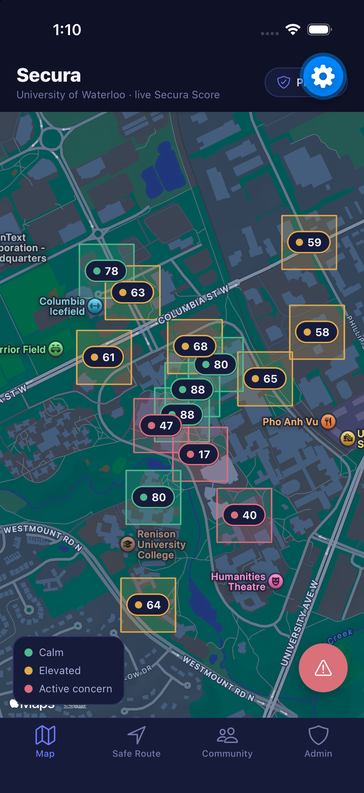

<div align="center">

# Secura

### A live campus safety map for the University of Waterloo

Crowd-sourced phone signals, corroborated by Verkada sensors, fused into one trustworthy Secura Score per zone.

Built for the UW Blueprint x Verkada Hackathon

[](https://docs.expo.dev/versions/v57.0.0/)
[](https://reactnative.dev/)
[](https://www.typescriptlang.org/)



</div>

---

## What it is

Secura overlays the University of Waterloo campus with about 16 named zones (Main Quad, Davis Centre, Engineering, residences, parking garages, and more), each showing a live Secura Score from 0 to 100. The score comes from fusing two signal sources instead of trusting either one alone:

- **Crowd-sourced phone data**, the primary signal: ambient noise-level buckets and presence/location density reported by nearby phones.
- **Verkada sensor corroboration**: motion, audio, thermal, access-control, and environmental events act as a trust layer. If a phone reports a spike but no sensor in the same zone backs it up, that report gets flagged and down-weighted as an outlier.

The idea is that a lot of noisy phones plus a few trustworthy fixed sensors are more reliable together than either one alone, and the app shows its math instead of hiding it behind a single number.

## Features

- **Live campus map**: color-coded zones (calm, elevated, active concern). Tap any zone for a full score breakdown, including phone reports, sensor corroboration, outliers filtered, and trend direction.
- **Safe Route**: From/To pickers let you choose a main campus zone from a dropdown or search for other named buildings, then compute a route weighted toward high-Secura-Score zones. Turn-by-turn style navigation animates a "you are here" puck along the route with ETA, current step, and an end-of-trip star rating that lightly feeds back into future routing.
- **Community tab**: students leave star-rated reviews per location, newest first. These feed a deliberately minor input into the score, with objective sensors staying around 90% of the weight and community input around 10%.
- **Quick incident reports**: a lightweight, anonymous-by-default button for poorly-lit paths, suspicious activity, unsafe crossings, or broken locks, kept separate from the fuller Community review flow.
- **Admin / Security view**: the full phone and Verkada breakdown per zone, an incident log, and action tiers (Monitor, Dispatch, Lockdown).
- **Privacy by design, not just claimed**: a persistent Privacy badge explains the architecture directly. Raw audio never leaves the phone (only a noise-level bucket does), raw Verkada payloads are discarded right after scoring, there's no facial recognition, and incident reports are anonymous by default.

## Campus zones modeled

Main Quad, Davis Centre, Dana Porter Library, Math & Computer (MC), Engineering, QNC, Physics, SLC / PAC, CIF, Village 1, REV, UW Place, Columbia Lake Village, Ring Road Parking Garage, South Campus, Conrad Grebel.

Safe Route search also covers other named buildings (Bombshelter Pub, Health Services, Renison, St. Jerome's, and more) that resolve to their nearest zone.

## Tech stack

- Expo (managed workflow, SDK 57), React Native, TypeScript
- react-native-maps for the live map, with a styled fallback view so the app doesn't crash if native maps aren't available
- React Navigation (bottom tabs) for Map, Safe Route, Community, and Admin
- AsyncStorage for session-local persistence of reviews, incident reports, and route ratings
- No backend. Phone reports and Verkada sensor events are simulated client-side through a fusion engine hook, so the whole demo runs standalone in Expo Go

## Getting started

```bash
npm install
npx expo start
```

Scan the QR code with Expo Go on iOS or Android to run it on a device, or press `i` / `a` for a simulator or emulator.

This project targets Expo SDK 57. Check the [versioned Expo docs](https://docs.expo.dev/versions/v57.0.0/) if you're extending it.

## Project structure

```
src/
  components/   Map, bottom sheets, location picker, privacy badge, incident button
  context/      App-wide data provider (reviews, incidents, ratings, persistence)
  data/         Zone definitions, campus path graph, location aliases, seed data
  hooks/        useFusionEngine, the phone + Verkada simulation and scoring logic
  navigation/   Bottom tab navigator
  screens/      Map, Safe Route, Community, Admin
  theme/        Indigo/navy palette and score-to-color helpers
  utils/        Safe Route path computation
```

## Privacy architecture

- Raw audio is never transmitted or stored. Each phone computes only a noise-level bucket on-device.
- Raw Verkada sensor payloads are discarded immediately after a score is derived from them.
- No facial recognition, no raw footage retained.
- Incident reports are anonymous by default.

These aren't just claims in the UI. They're reflected in how [`useFusionEngine.ts`](src/hooks/useFusionEngine.ts) is actually structured.

---

<div align="center">

Built in one evening for the UW Blueprint x Verkada Hackathon.

</div>
